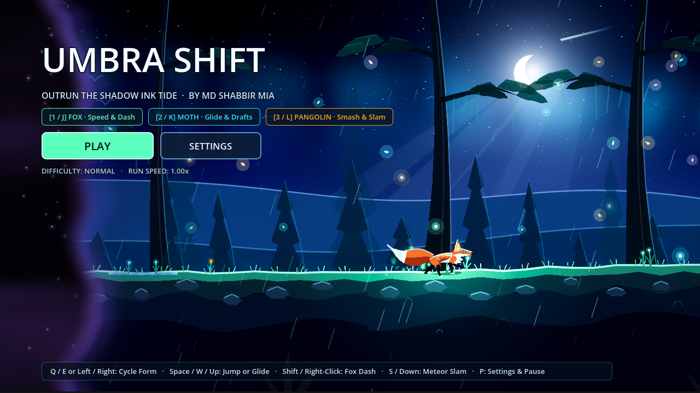
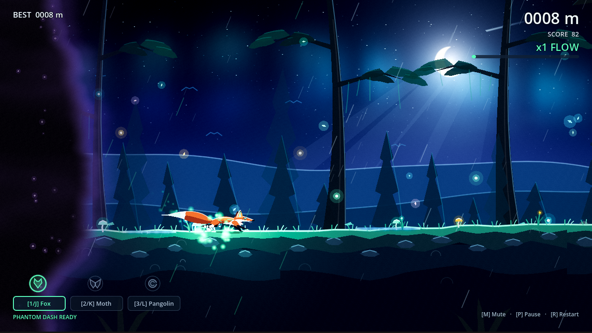
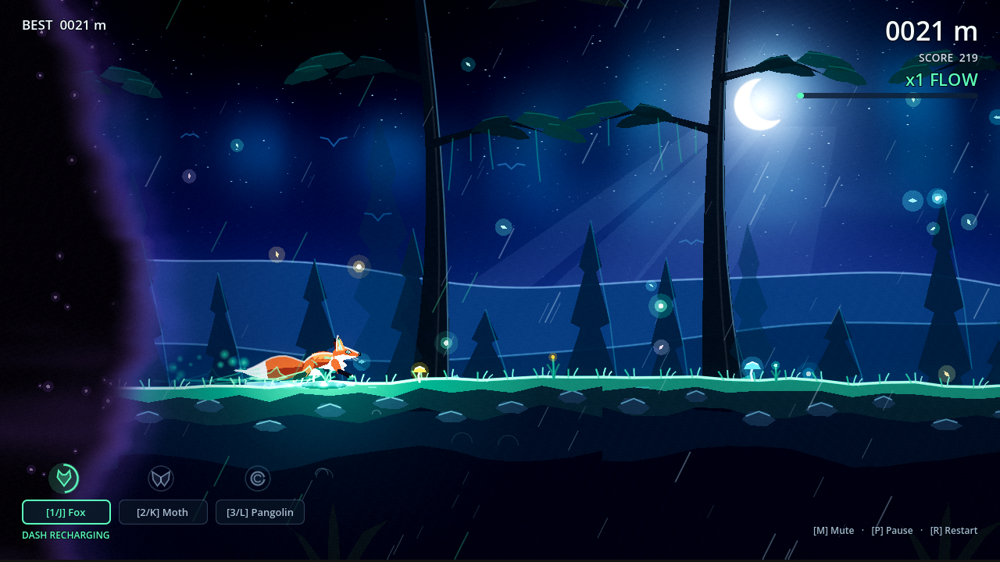
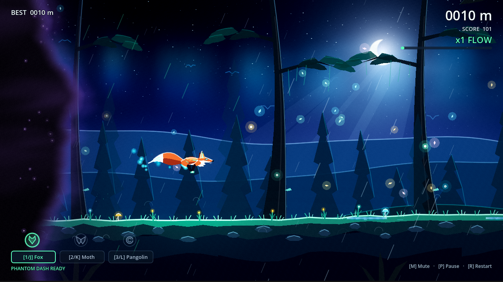
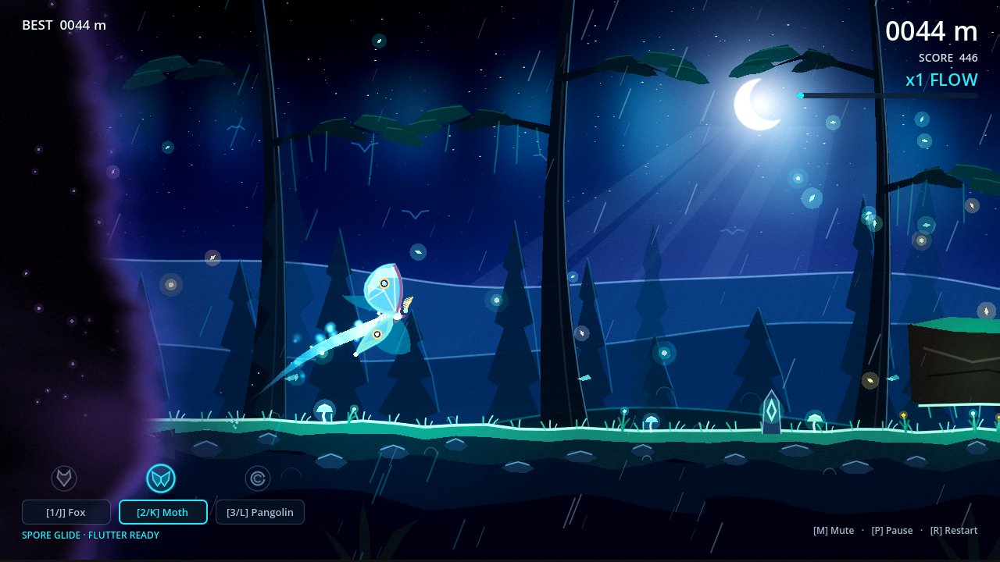
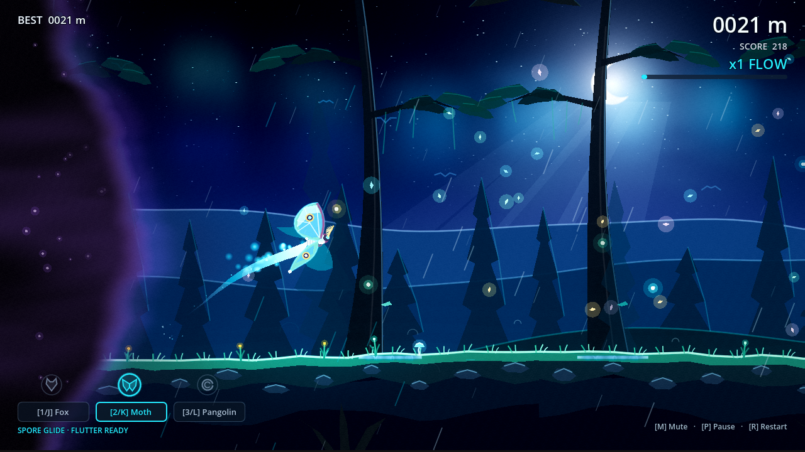
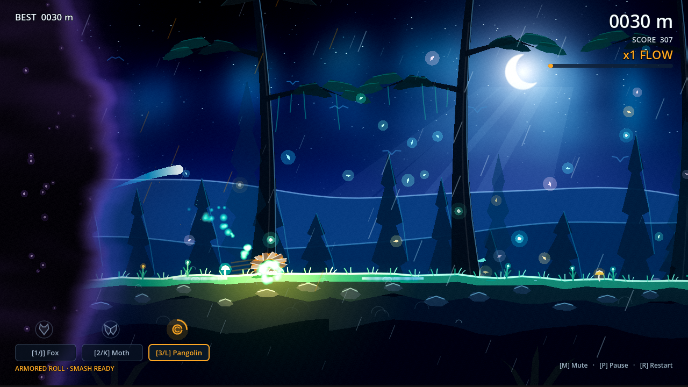
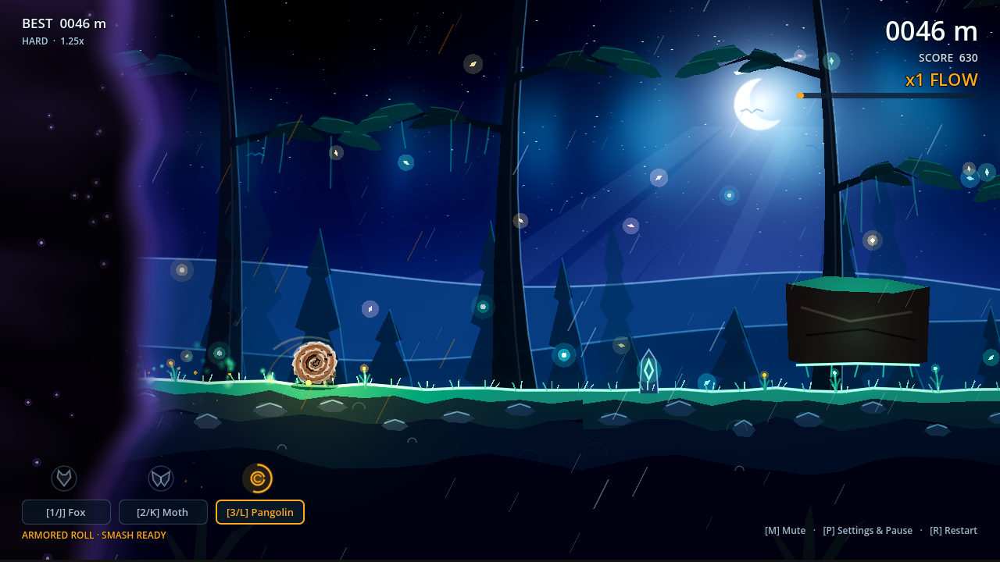
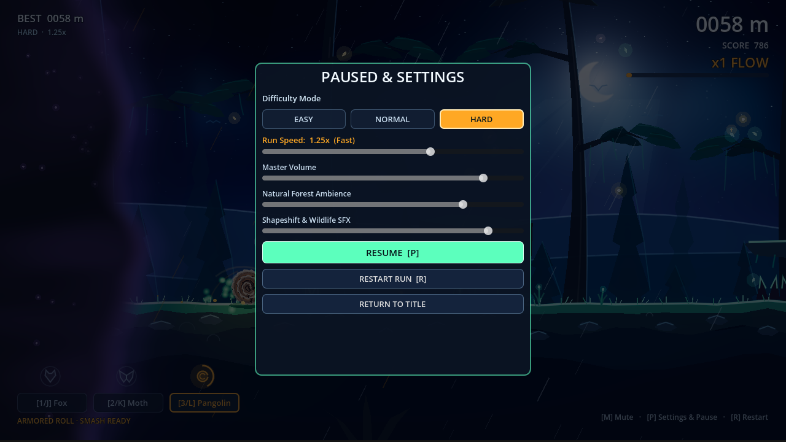
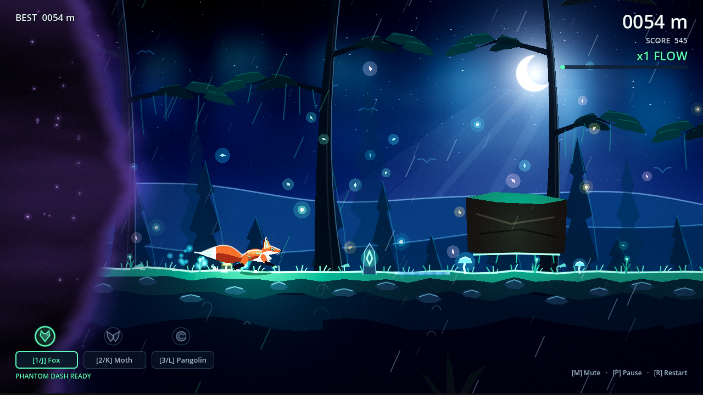

# UMBRA SHIFT

**Created by Md Shabbir Mia**

An atmospheric, locked 60 FPS 2D shapeshifting endless runner built in **Godot 4 (GDScript + GLSL CanvasItem Shaders)** with custom procedural animation, hand-tuned natural wildlife palettes, and a real-time synthesized woodland soundscape — using zero external sprites, textures, fonts, or audio assets.

Flee through a moonlit twilight forest while pursued by the living **Shadow Ink Tide**, shifting seamlessly between a **Red Spirit Fox**, an **Actias Luna Moth**, and an **Armored Pangolin** to overcome terrain, shatter obstacles, and build your **Flow Multiplier (`x1` – `x10`)**.



---

## Feature Showcase

### 1. Live Atmospheric Title Screen & Quick Settings
Opens directly into the animated twilight forest with a crescent moon, volumetric moonbeams, drifting fireflies, soft rainfall, swaying ferns, the Red Fox breathing on mossy ground, and the creeping violet Shadow Ink Tide on the horizon — with direct **PLAY** and **SETTINGS** controls plus live **Difficulty & Run Speed** status.


### 2. Red Spirit Fox — Gallop & Forest Sprint
Natural auburn-orange fur with a cream cheek ruff, black paws, white-tipped Verlet brush tail, articulated digitigrade legs, and spring-damped gait motion across mossy turf and glowing woodland mushrooms.



### 3. Fox Phantom Dash & Reflective Rain Puddles
Trigger a rapid horizontal burst (`Shift` or `Right-Click`) that slips cleanly beneath low root overhangs, leaves glowing mint afterimages, splashes across shader-reflected rain puddles, and displays live cooldown status on the HUD.



### 4. Responsive Double-Jump & Aerial Flow
Fluid mid-air leap arcs with coyote time, jump buffering, horizontal tail extension, and glowing jump-burst particles over uneven forest ground and ancient runestones.



### 5. Actias Luna Moth — Moonlit Aurora Glide
Instant morph into a celadon-winged Luna Moth featuring plum leading wing edges, golden-amber eyespots, feathery antennae, a trailing cyan flight ribbon, and effortless gliding across cliffs and ravines.



### 6. Luna Moth — Wingbeat Flutter & Bioluminescent Spores
Tap jump in mid-air for crisp wingbeat lift with luminous scale dust, dynamic upstroke wing tilt, and automatic high-altitude camera framing so upcoming terrain stays clearly readable.



### 7. Armored Pangolin — Keratin Scales & Heavy Stride
Morph into a bronze-keratin Armored Pangolin with overlapping plated scales, molten-amber underglow, warm ground illumination, and instant amber theme synchronization across the HUD and flow bar.



### 8. Pangolin Meteor Slam & Realistic Shingled Armored Roll
Dive with `S` / `Down` to curl into a tightly shingled, overlapping bronze-keratin armored ball with an organic coiled tail spiral and curved wind slipstreams — smashing straight through brambles and cracked monoliths while searing glowing fractures into the mossy earth.



### 9. Settings & Pause Menu — Difficulty Modes, Run Speed & Audio Mixer
Open **SETTINGS** from the Title Screen or press `P` / `Esc` mid-run to switch between **Easy**, **Normal**, and **Hard** difficulty modes, fine-tune your **Run Speed (`0.60x` – `1.60x`)**, and balance **Master Volume**, **Natural Forest Ambience**, and **Shapeshift & Wildlife SFX** in real time.



### 10. Shadow Ink Tide Chase, Obstacles & Dynamic HUD
Outrun the smoky violet Shadow Ink Tide as distance, score, and Flow climb through procedural terrain chunks featuring weathered mossy cliffs, glowing runestones, and dynamic form-reactive HUD indicators.



---

## Natural Woodland Soundscape

Instead of harsh static or white noise, `procedural_audio.gd` synthesizes a calm, organic forest soundscape in real time using Godot's `AudioStreamGenerator`:

- **Warm Forest Pad**: Soft pentatonic twilight chords that breathe gently in the background.
- **Natural Woodland Life**: Periodic dew water droplets, distant hollow owl-flute calls, and soft summer crickets.
- **Tactile Gameplay SFX**: Distinct musical chimes and natural acoustic cues for Fox leaps & dashes, Moth silky wing flutters, Pangolin rock-smashing impacts, form shifts, and rising Flow milestones.

---

## Difficulty Modes, Run Speed & Pure Godot 4 Optimization

- **Difficulty Modes (`Easy` / `Normal` / `Hard`)**: Adjusts base pace, Shadow Ink Tide pursuit aggression, stumble recovery grace, and score multiplier (`0.85x` / `1.00x` / `1.35x`).
- **Custom Run Speed (`0.60x` – `1.60x`)**: Smoothly dial your preferred pace from Relaxed (`0.60x`) to Turbo (`1.60x`) inside Settings — persisted automatically alongside your chosen difficulty and high scores in `user://highscore.cfg`.
- **100% Pure Godot 4 Performance**: Pre-baked terrain geology polygons, viewport frustum culling, batched `draw_multiline()` grass & rain passes, zero-GC Structure-of-Arrays (SoA) VFX/audio pools, bulk `AudioStreamGeneratorPlayback.push_buffer()`, and branch-guarded GLSL shaders for silky-smooth 60 FPS gameplay.

---

## Controls

| Action | Keys / Input |
| :--- | :--- |
| **Shift to Fox** | `1` or `J` |
| **Shift to Luna Moth** | `2` or `K` |
| **Shift to Armored Pangolin** | `3` or `L` |
| **Cycle Forms Left / Right** | `Q` / `E` or `Left` / `Right` |
| **Jump / Double-Jump / Moth Flutter & Hold-to-Glide** | `Space`, `W`, or `Up` |
| **Fox Phantom Dash** (slides under low overhangs) | `Shift` or `Right-Click` |
| **Pangolin Meteor Slam / Armored Roll** | `S` or `Down` |
| **Pause / Audio Mixer** | `P` or `Esc` |
| **Instant Restart** | `R` |
| **Mute / Unmute Audio** | `M` |

You can also click any of the three form cards in the bottom-left HUD to shift directly.

---

## How to Open & Run in Godot 4

1. Install **Godot Engine 4.3+** (Standard GDScript edition).
2. Open the **Godot Project Manager** and click **Import**.
3. Select `project.godot` in the root of this repository and click **Import & Edit**.
4. Press **F5** (or click **Play**) to launch `res://scenes/main.tscn`.

> Best distance and high scores are saved automatically to `user://highscore.cfg`.

---

## Project Structure

```text
.
├── project.godot                     # Godot 4 project config (1280x720 keep stretch, HDR 2D, input map)
├── LICENSE                           # MIT License
├── README.md                         # Documentation & live feature gallery
├── docs/
│   ├── .gdignore                     # Keeps documentation images out of Godot asset imports
│   └── screenshots/                  # 10 live gameplay feature screenshots
├── resources/
│   └── world_env.tres                # WorldEnvironment HDR bloom & tonemapping
├── scenes/
│   ├── main.tscn                     # Root scene (WorldEnvironment, parallax forest, Player, CameraRig, InkTide, HUD, Audio)
│   ├── player.tscn                   # CharacterBody2D with aura PointLight2D, MothRibbon Line2D, and 3 creature renderers
│   ├── ink_tide.tscn                 # Shadow Ink Tide shader overlay & drifting shadow embers
│   ├── hud.tscn                      # Minimalist HUD, Pause Audio Mixer modal, and Game Over summary
│   └── title_overlay.tscn            # Live animated Title Screen overlay
├── scripts/
│   ├── main.gd                       # Game state machine, hitstop, collision handling, and score flow
│   ├── player.gd                     # 3-form physics, coyote time, jump/morph buffering, momentum conservation
│   ├── fox_renderer.gd               # Procedural Red Spirit Fox anatomy & digitigrade gallop animation
│   ├── moth_renderer.gd              # Procedural Actias Luna Moth wings, eyespots, antennae & wingbeat animation
│   ├── pangolin_renderer.gd          # Procedural Armored Pangolin scales, stride & curled volcanic roll
│   ├── environment_manager.gd        # Multi-layer parallax twilight forest, crescent moon, moonbeams & foliage
│   ├── weather_system.gd             # Layered diagonal rainfall, fireflies, spores & atmospheric gusts
│   ├── level_generator.gd            # Procedural clearable terrain chunks, cliffs, rain puddles & runestones
│   ├── obstacle.gd                   # Smashable monoliths, brambles, overhangs & Spore-Draft updrafts
│   ├── reactive_flora.gd             # Spring-physics grass blades, glowing mushrooms & bending ferns
│   ├── fracture_system.gd            # Molten-amber ground fracture cracks & impact shockwaves
│   ├── camera_rig.gd                 # Look-ahead framing, form-aware zoom & smooth trauma shake
│   ├── vfx_manager.gd                # Zero-GC pooled sparks, morph rings, afterimages, ripples & debris
│   ├── ink_tide.gd                   # Living Shadow Ink Tide proximity & surge controller
│   ├── score_manager.gd              # Distance, Flow multiplier, combo streaks & highscore persistence
│   ├── procedural_audio.gd           # Pure AudioStreamGenerator natural forest ambience & wildlife SFX
│   └── hud.gd                        # Vector form badges, Flow bar, Pause audio sliders & Game Over UI
└── shaders/
    ├── sky_storm.gdshader            # Twilight aurora sky gradient, stars & drifting clouds
    ├── wind_sway.gdshader            # Gentle wind sway for distant woodland canopies
    ├── puddle_reflect.gdshader       # Rippling rainwater puddle reflections
    ├── ink_tide.gdshader             # Flowing watercolor Shadow Ink Tide edge shader
    └── post_atmosphere.gdshader      # Subtle Flow speed lines & morph rim pulse
```

---

## License

This project is licensed under the **MIT License** — see the [LICENSE](LICENSE) file for details.

---

## Author

**Md Shabbir Mia**
